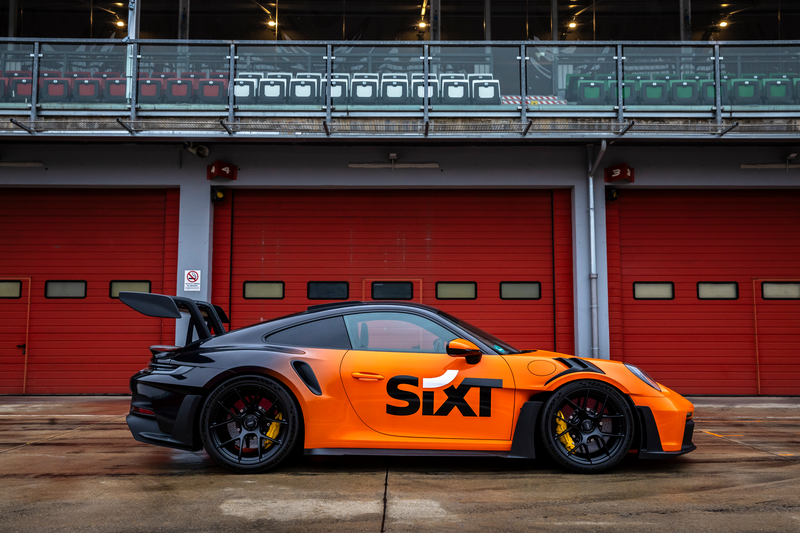

# Sixt @hackaTUM



## Challenge brief

Sixt is accelerating the digitalization of its core rental product. While our booking flow has been fully digital for decades, the checkout and counter experience—historically delivered by rental sales agents—remains the most impactful part of the customer journey. The central challenge is upselling: matching the effectiveness, personalization, and situational nuance of in-person agents in a seamless digital flow.
Your task is to design and prototype an outstanding digital upsell experience that rivals the counter. Focus on core revenue-drivers such as vehicle upgrades, protection products, and optional add-ons. Leverage the latest possibilities of generative AI to deliver personalized recommendations, contextual sales guidance, dynamic storytelling, or entirely new interaction patterns that a human agent could never scale. The goal is to redefine how customers discover value—intuitively, transparently, and with delight—before they start their journey with Sixt.

## API

### Base URL
```https://hackatum25.sixt.io/```


### Create Booking
```POST /api/booking```

### Get Booking
```GET /api/booking/<BOOKING_ID>```

### Get available vehicles for vehicle selection
```GET /api/booking/<BOOKING_ID>/vehicles```

### Get available protection packages for booking
```GET /api/booking/<BOOKING_ID>/protections```

### Get available addons for booking
```GET /api/booking/<BOOKING_ID>/addons```

### Assign vehicle to booking
```POST /api/booking/<BOOKING_ID>/vehicles/<VEHICLE_ID>```

### Assign protection package to booking
```POST /api/booking/<BOOKING_ID>/protections/<PACKAGE_ID>```

### Complete Booking
```POST /api/booking/<BOOKING_ID>/complete```

### Sixt Vehicle on the Campus
We have a car parked at the campus, this car can be unlocked / locked / letting it blink via API

```POST /api/car/lock```

```POST /api/car/unlock```

```POST /api/car/blink```


[](https://app.getpostman.com/run/collection/50137785-5b48c660-f463-42e5-b16a-a82d02c525f3?action=collection%2F50137785-5b48c660-f463-42e5-b16a-a82d02c525f3)